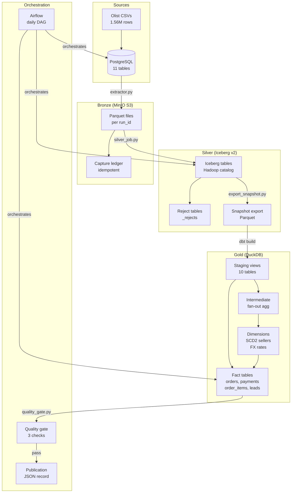

# CommercePulse – Reliable E-commerce Lakehouse

A governed, end-to-end data platform built on the Brazilian Olist e-commerce dataset.
Demonstrates a full medallion architecture (bronze → silver → gold) with data contracts,
SCD2 dimensions, fan-out prevention, quality gates, and idempotent orchestration.

## Architecture



## Data Stack

| Layer | Technology | Key Feature |
|-------|-----------|-------------|
| Source | PostgreSQL 16, Olist CSVs | 1.56M rows seeded |
| Bronze | MinIO (S3-compatible) + Parquet | Idempotent extraction via run_id ledger |
| Silver | PySpark 4.0 + Iceberg v2 | Validation, dedup, schema evolution, time-travel |
| Gold | dbt-core + DuckDB | SCD2 sellers, fan-out prevention, FX conversion |
| Orchestration | Airflow 2.9 | Daily DAG, backfill DAG, quality gate, publication |
| CI | GitHub Actions | Unit tests + dbt build on every push |

## Quick Start

```bash
# 1. Start infrastructure (Postgres + MinIO)
make up

# 2. Seed Postgres with Olist data (~71s)
make seed

# 3. Run bronze extraction (Postgres → MinIO Parquet, ~4s)
make extract

# 4. Run silver PySpark job (bronze → Iceberg, ~14s)
make silver

# 5. Export silver snapshots to Parquet (for dbt)
make export-gold

# 6. Backfill FX rates 2016–2018 (requires internet)
make backfill-fx

# 7. Install dbt packages and build gold layer
make dbt-deps dbt-build-core

# 8. Run quality gate
python scripts/quality_gate.py

# 9. Publish report
python scripts/publish.py

# Or run the full pipeline end-to-end:
make pipeline
```

## Measured Results

| Phase | Metric | Value |
|-------|--------|-------|
| Seed | Rows loaded | 1,559,764 across 11 tables |
| Bronze | Extraction time | ~4s |
| Silver | Tables processed | 7 tables, 550,688 rows |
| Silver | Lake checks | All passed |
| Gold | dbt models | 14 models, 66 tests |
| Gold | All tests pass | 66/66 ✅ |
| Quality gate | Fulfilled GMV | R$13,220,248.93 |
| Quality gate | Delivered orders | 96,470 / 99,441 |
| Unit tests | Non-integration | 26/26 ✅ |

## Key Design Decisions

See [docs/decisions.md](docs/decisions.md) for full ADRs.

- **Idempotent bronze**: run_id ledger prevents duplicate extractions
- **Fan-out prevention**: order_items aggregated to (order_id, seller_id) before joining sellers
- **SCD2 sellers**: surrogate key + valid_from/valid_to structure ready for change events
- **Quality gate**: surfaces reconciliation mismatches; hard-fails only above 5% threshold
- **Parquet bridge**: silver Iceberg exported to Parquet so dbt/DuckDB can read it locally

## Project Structure

```
.
├── ingestion/          # Bronze: Postgres → MinIO (extractor, seed, profiler, fx_client)
├── lakehouse/          # Silver: PySpark + Iceberg (silver_job, export_snapshot, spark_session)
├── warehouse/dbt/      # Gold: dbt + DuckDB (staging, intermediate, dimensions, marts)
├── orchestration/dags/ # Airflow DAGs (pipeline, backfill)
├── scripts/            # CLI tools (quality_gate, publish, backfill_fx)
├── replay/             # Failure injection helpers
├── tests/              # pytest (unit + integration + failure injection)
├── contracts/          # Metric contracts YAML
├── docs/               # Decisions, profiling, incident report
├── infra/              # Docker Compose (Postgres, MinIO, Airflow, Kafka, ClickHouse)
└── benchmarks/         # Real measured benchmark results
```

## Metric Contracts

Defined in [contracts/metrics.yml](contracts/metrics.yml):

| Metric | Definition | Mart |
|--------|-----------|------|
| `fulfilled_gmv` | SUM(price) for delivered orders | `fct_orders` |
| `payment_reconciliation` | payment_total vs item+freight gap | `fct_payments` |
| `seller_conversion` | closed_deals / qualified_leads by origin | `fct_seller_leads` |
| `seller_gmv_attribution` | per-seller GMV (split, no double-count) | `fct_order_items` |
| `observed_demand` | orders by date/category/seller/status | `fct_order_items` |
